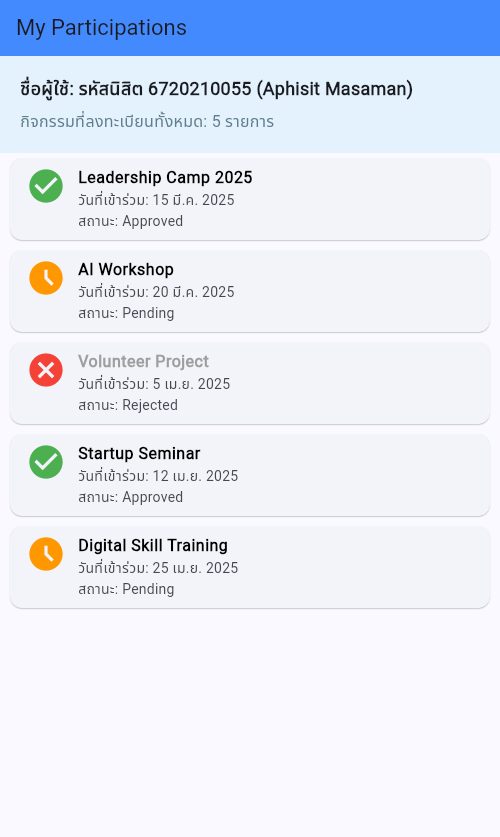
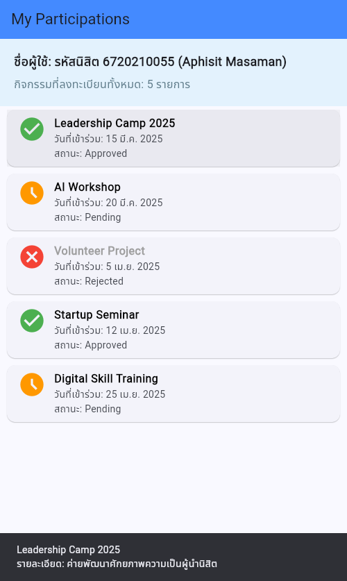

# Lab 03 (In-Home) • หน้าจอประวัติการเข้าร่วมกิจกรรม (My Participations)

กิจกรรมฝึกปฏิบัติท้ายบท: **การออกแบบและพัฒนาส่วนติดต่อผู้ใช้ (UI) สำหรับหน้าจอประวัติการเข้าร่วมกิจกรรมด้วย Flutter**

---

## 👨‍💻 ข้อมูลผู้พัฒนา
- **ชื่อ-นามสกุล:** นายอภิสิทธิ์ มาสะมัน (Aphisit Masaman)
- **รหัสนิสิต:** 6720210055
- **GitHub Repository:** [https://github.com/aphisitmasaman2548/lab03-inHome-055](https://github.com/aphisitmasaman2548/lab03-inHome-055)

---

## 🎯 วัตถุประสงค์ (Objectives)
1. สามารถใช้ Widget จัดโครงสร้างพื้นฐาน (`Column`, `Container`, `Expanded`, `Padding`) ในการออกแบบหน้าจอแอปพลิเคชันได้
2. สามารถนำเสนอข้อมูลแบบรายการที่มีประสิทธิภาพด้วย `ListView.builder()` ได้
3. สามารถเขียนเงื่อนไข (Conditional UI) เพื่อปรับเปลี่ยนรูปแบบการแสดงผล (สีและไอคอน) ตามสถานะของข้อมูลได้
4. สามารถสร้างปฏิสัมพันธ์โต้ตอบพื้นฐานผ่านป๊อปอัปข้อความ (`SnackBar`) ได้

---

## 📱 ภาพผลลัพธ์หน้าจอจริง (Screenshots)

| หน้าจอหลักแสดงรายการประวัติกิจกรรม (5 รายการ) | เมื่อกด (Tap) เพื่อแสดงรายละเอียดผ่าน SnackBar |
| :---: | :---: |
|  |  |

---

## 🧩 โครงสร้างโปรเจกต์และไฟล์สำคัญ (Project Structure)

```
lab03-inHome/
├── README.md                          # เอกสารสรุปโปรเจกต์และภาพผลลัพธ์
├── screenshot.png                     # ภาพผลการรันหน้าจอหลัก
├── screenshot_snackbar.png            # ภาพผลการรันเมื่อแสดง SnackBar
└── app/
    ├── lib/
    │   ├── main.dart                  # จุดเริ่มต้นแอปพลิเคชัน เรียกใช้ MyParticipationsScreen()
    │   ├── my_participations_screen.dart # หน้าจอหลัก Scaffold, Header, ListView.builder, SnackBar
    │   └── participation_model.dart   # คลาสโมเดล Participation และข้อมูลจำลอง mockParticipations 5 รายการ
    └── pubspec.yaml                   # ไฟล์ตั้งค่า Dependencies ของ Flutter
```

---

## ⚙️ ขั้นตอนการพัฒนาตามโจทย์ (Implementation Steps)

1. **ขั้นที่ 1: เตรียมคลาสโมเดลและข้อมูลจำลอง (`participation_model.dart`)**
   - สร้างคลาส `Participation` เก็บข้อมูล `activityName`, `description`, `participantDate`, และ `status`
   - เตรียม `mockParticipations` ข้อมูลจำลอง 5 รายการที่มีสถานะครบทั้ง `Approved`, `Pending`, และ `Rejected`

2. **ขั้นที่ 2: สร้างโครงสร้างหลักของหน้าจอ (`my_participations_screen.dart`)**
   - ใช้ `Scaffold` และ `Column` ในการจัดวางพื้นที่ Header และ List

3. **ขั้นที่ 3: ออกแบบส่วนหัวหน้าจอ (Header Section)**
   - ใช้ฟังก์ชัน `_buildHeaderSection()` ครอบด้วย `Container` สี `Colors.blue.shade50`
   - แสดงชื่อผู้ใช้/รหัสนิสิต และจำนวนกิจกรรมทั้งหมด (`mockParticipations.length`)

4. **ขั้นที่ 4 & 5: การสร้างรายการ (ListView.builder) และเงื่อนไขสถานะ (Conditional UI)**
   - ใช้ `Expanded` ร่วมกับ `ListView.builder` เพื่อให้รายการขยายเต็มพื้นที่ที่เหลือ
   - ใช้เงื่อนไข `if-else` กำหนดสีและไอคอนตามสถานะ:
     - 🟢 **Approved**: ไอคอน `Icons.check_circle` สีเขียว (`Colors.green`)
     - 🟠 **Pending**: ไอคอน `Icons.access_time_filled` สีส้ม (`Colors.orange`)
     - 🔴 **Rejected**: ไอคอน `Icons.cancel` สีแดง (`Colors.red`) และข้อความสีเทา (`Colors.grey`)
   - แสดงผลใน `Card` และ `ListTile` พร้อม `isThreeLine: true`
   - เพิ่มเหตุการณ์ `onTap` เรียก `ScaffoldMessenger.of(context).showSnackBar()` แสดงชื่อและรายละเอียดกิจกรรมนาน 3 วินาที

5. **ขั้นที่ 6: เรียกใช้งานใน `main.dart`**
   - กำหนดให้ `home: const MyParticipationsScreen()` เพื่อแสดงหน้าจอเมื่อเริ่มแอป

---

## 🚀 วิธีการติดตั้งและรันโปรเจกต์ (Getting Started)

1. เข้าไปยังโฟลเดอร์ `app`:
   ```bash
   cd app
   ```

2. ดึง Dependencies:
   ```bash
   flutter pub get
   ```

3. รันแอปพลิเคชัน:
   ```bash
   flutter run
   ```
